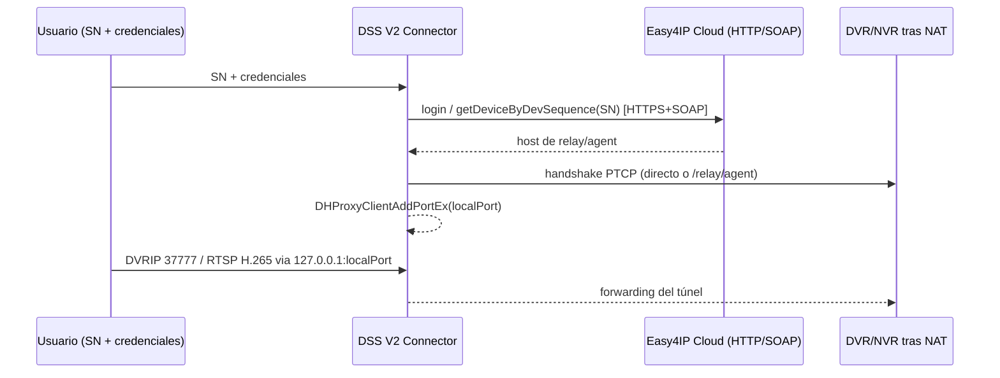

# P2P_RESEARCH.md — Investigación P2P Dahua

Objetivo: consolidar lo que sabemos (y lo que falta) sobre cómo un servidor propio puede alcanzar
NVRs Dahua **detrás de NAT** usando el número de serie (SN), y evaluar rutas legítimas (oficiales)
frente a rutas observadas por ingeniería inversa comunitaria.

## 1. Estado resumen

| Pregunta | Respuesta actual | Confianza | Evidencia |
|---|---|---|---|
| ¿Existe SDK oficial Linux con P2P listo para terceros? | NetSDK Linux x64 existe; ruta P2P no operativa standalone (según un reporte) | PROBABLE | EV-004, EV-005 |
| ¿Qué rol juega el P2P en producción hoy? | Los NVRs se agregan por SN vía el P2P cloud de Dahua | CONFIRMADO (por nuestra operación) | EV-012 |
| ¿Se ha descrito el protocolo P2P? | Sí, en PoC público (dh-p2p): nube Easy4IP + relay + PTCP | PROBABLE | EV-006 |
| ¿Existe alternativa oficial tipo partner? | DoLynk Developer cloud + programa Partner DSS (DEPP) a investigar | NO VERIFICADO | EV-008, EV-009 |
| ¿Sirve RTSP local detrás de NAT? | No por sí solo (sin IP pública) | DESCARTADO como ruta principal | EV-006 (motivación) |

## 2. Rutas posibles al video del NVR detrás de NAT

| Ruta | Descripción | Legalidad/licencia | Veredicto |
|---|---|---|---|
| A. NetSDK oficial + P2P | Usar librerías oficiales Linux; probar los paths P2P que integre el SDK | Limpia (SDK oficial) | **Prioridad 1** (E-002) |
| B. DoLynk Developer Cloud | Re-registrar dispositivos en la plataforma IoT oficial y usar su OpenAPI | Limpia, si aplica a NVRs | Prioridad 2 (E-003-B) |
| C. Partner DSS Integration | Acceso vía programa de partners a SDK/API oficial del ecosistema | Limpia | Prioridad 3 (E-004) |
| D. Reimplementar protocolo (estilo dh-p2p) | Cliente propio de Easy4IP + PTCP | Gris: implementa protocolo observado; los "secretos de app" de Dahua NO se reutilizan (ADR-0004) | Solo laboratorio con autorización; no producción sin revisión legal (E-005) |
| E. Túneles genéricos por sitio (VPN/SSH) | Configurar la red del cliente: WireGuard hacia el server desde el sitio del NVR | Limpia, requiere coordinación local | Alternativa fría válida para despliegue |

## 3. Arquitectura P2P según evidencia comunitaria (EV-006) — a verificar

```
   NVR (SN)                   Cloud Dahua (Easy4IP / dahuap2p)               Conector DSS V2
   ────────                   ──────────────────────────────                 ───────────────
      │  registro SN + keepalive     │
      │──────────────────────────────>│
                                    │  orden de preparación de conexión
                                    │<─────────────────────────────────  consulta por SN (probe/info)
                                    │─────────────────────────────────>  (rendezvous)
      │<═══════ UDP PTCP (TCP-sobre-UDP) o relay ════════════════════════════│
      │        sesión DVRIP/RTSP sobre el túnel                        │
```

Componentes descritos:
1. **Lookup por SN:** `/online/p2psrv/{SN}` — estado del dispositivo y lista de servidores.
2. **Información del dispositivo:** `/info/device/{SN}` — puertos (`privport` 37777, `tlsprivport` 37778, `rtspport` 554, `httpport` 80) y `randsalt` (realm del hash de contraseña).
3. **Rendezvous/relay:** `/relay/agent` + `/relay/start/{token}` cuando el hole-punching UDP falla.
4. **PTCP:** transporte propietario TCP-sobre-UDP; cabecera de 24 bytes; tipos 0x00/0x10/0x11/0x12/0x13/0x19–0x1b.
5. **Sesión de aplicación:** DVRIP (privport) para control y RTSP para video; el PoC demuestra RTSP sobre el túnel.

Todo lo anterior: **PROBABLE** (implementación pública que terceros afirmaron reproducir).
No se declara conclusión hasta reproducirlo en el laboratorio con dispositivos propios (E-005).

## 4. Advertencias

- **Secretos de app Dahua:** los PoCs comunitarios usan identificadores fijos incrustados en
  SmartPSS/DMSS para autenticarse frente a la nube de Dahua. **Este proyecto no extrae ni reutiliza
  esos secretos** (ADR-0004). Si la ruta D se persigue en producción, será con credenciales propias
  autorizadas por Dahua y revisión legal explícita.
- **El SN no debe ser la única llave:** EV-011 demuestra que en entornos mal configurados el SN puede
  bastar para alcanzar dispositivos. DSS V2 debe: (a) exigir siempre usuario/contraseña,
  (b) guardar credenciales cifradas, (c) registrar todo acceso.
- **La nube es punto único de dependencia:** la disponibilidad del P2P depende del cloud de Dahua.
  DSS V2 debe tratar la nube como fuente de degradación (estado offline con reconexión) y preferir
  rutas directas cuando existan.

## 5. Plan de verificación

| Experimento | Contenido |
|---|---|
| E-002 | Validar NetSDK Linux x64 en Ubuntu 24.04 (login, canales, video) — incluyendo cualquier capacidad P2P integrada en el SDK |
| E-003 | Observar la nube P2P en producción: DNS hacia easy4ip/dahuap2p; sesión P2P de un cliente con el equipo de laboratorio; fases A y B (DoLynk) |
| E-005 | PoC DSS V2 P2P CONNECTOR: criterio de aceptación — video real de un NVR detrás de NAT |

Documento asociado para DSS Client/Server: ver `docs/DSS_CLIENT_RESEARCH.md`.


## 6. Evidencia estática DPSDK/P2PDll (E-006 V2, 2026-10-30)

Fuente: `scan-4-dlls.mjs` sobre las 4 DLLs (client V8.006 `dssclient-extracted` y server-pkgB `unpack-inner-1376402688`) — ver EV-026/EV-027.

| Capa | Hallazgo | Confianza |
|---|---|---|
| DPSDK.dll (generaciones client `: ce43c8b7…` y server-pkgB `3f49799f…`) | `www.easy4ip.com`, `www.easy4ipcloud.com`, `GetDeviceInfoFromEasy4IP`, `ParseHttpBodyForEasy4IP`, `CP2PServerManager` (`LoginP2PServer`, `AddP2PP2Mapping`), `GetP2PConfig/UpdateP2PConfig/GetP2PServerList/GetP2PDeviceInfo`, `SetP2PClientType`, `pP2PServerDomain` | CONFIRMADO |
| P2PDll.dll (8 exports `P2P_*`) | transporte: `p2pchannel timeout`, `Use P2P Link! %p localPort:%d, remotePort[%d]`, `all fail,p2p:` | CONFIRMADO |
| Build path filtrada (pkgB DPSDK) | `d:\jk_107\workspace\Module_Software-HW_DSS-Client_OverseasClient_W_OverseasClient_windows\code_path\PlatformSDK__3caad5\C\DPSDK\Logic\P2P\P2PServerManager.cpp` | CONFIRMADO |

Corrección de registro: búsquedas previas case-sensitive con `easy4ip: 0 resultados` (`ev_4971b2ca`/`ev_ef79f8af`) quedan supersedidas (EV-027). El plan de laboratorio (E-003/E-005) gana un objetivo concreto: logar el flujo `LoginP2PServer → GetP2PServerList → GetDeviceInfoFromEasy4IP` capturando DNS/TLS de `*.easy4ip*.com`.


## 7. PoC "DSS V2 P2P Connector" — especificación (E-007, EV-031/EV-032)

Diagrama de secuencia objetivo (base estática confirmada):



Arquitectura elegida (ADR-0009): proceso propio con dos módulos — (1) dsv2-cloud-dialer: reimplementación del lookup (HTTPS/SOAP ya observados en DPSDK) y del handshake PTCP/Tou, tomando como referencia abierta el PoC MIT dh-p2p (EV-006); (2) dsv2-port-forward: escucha local en loopback y multiplexa hacia DVRIP/RTSP. No se redistribuye P2PDll.dll ni material no sintético de Dahua (ADR-0003/0004).
Limitación de conocimiento: puertos UDP del cloud y magia de paquetes quedan PROBABLE hasta E-008 (captura dinámica con SN legítimo propio).


## 8. Evidencia detallada P2P (E-008, EV-034/035/036)

### 8.1 SOAP Easy4IP (EV-034)
```xml
<ns2:getDeviceByDevSequence xmlns:ns2="http://webservice.ddns.dahua.com/">
  <devSequence>SN123456789</devSequence>
</ns2:getDeviceByDevSequence>
```
Llamado desde `Dpsdk::CP2PServerManager::LoginP2PServer` → `StartP2PTraversal` → `GetDeviceInfoFromEasy4IP` → `ParseHttpBodyForEasy4IP`.

### 8.2 Dominios cloud (EV-035)
`www.easy4ip.com`, `www.easy4ipcloud.com`, `www.dahuap2p.com`, `www.dahuap2pcloud.com`, IP `172.23.1.120` (staging).

### 8.3 Pseudocódigo P2PDll (EV-036)
```c
// P2P_Connect -> DHProxyClientAddPortEx
int DHProxyClientAddPortEx(Handler h, ..., uint32_t* localPort) {
  if (!g_Client) return -1;           // instancia única
  *localPort = (uint16_t)*localPort;  // recorta a u16
  return g_Client->AddPortEx(...);    // libTouProxy
}
```
Motor: `Dahua::Tou::parseSn`, `ptcp connect success`, `/relay/agent`, `agenthost:`, bind `127.0.0.1`.

## 9. PoC Scaffolding (E-008, EV-038/039)

### 9.1 Mock BRMS Gateway (EV-038)
```bash
cd poc/dss-v2-harness/brms-gateway
npm install && npm test
```
Tests validan: handshake 401→200 (realm+randomKey, double MD5, WINPC_V2), X-Subject-Token, tree/orgs/devices/channels, MTS StartVideo→RTSP/HLS.

### 9.2 P2P Probe (EV-039)
```bash
cd poc/dss-v2-harness/p2p-probe
npm install
SN=<serial> USER=admin PASS=admin123 node src/index.js
```
Envía SOAP exacto EV-034, parsea relay, stub `touHandshake` para `DHProxyClientAddPortEx`.
## 10. libTouProxy Deep Dive (E-009, EV-040)

### 10.1 Call Chain
```
P2P_Init → DHProxyClientInit → getDomainIP (DNS) → ProxyClientImpl (singleton)
P2P_Connect → DHProxyClientAddPortEx → FUN_18001d1d0 → createLocalPort
P2P_GetDeviceInfo → vtable[0x20] → jsonDevInfo
```

### 10.2 createLocalPort (FUN_18001c8e0)
1. `bind(0.0.0.0, localPort)` UDP
2. Validate `remoteIp == 127.0.0.1 || ::1` (rejecta IPs públicas)
3. `listen()` socket
4. Register in `CPortResource` map: `key=localPort` → channel context
5. Returns `localPort` to caller (truncado a u16)

### 10.3 Relay & PTCP
- `/relay/agent` endpoint para coordinación de relay
- `agenthost:` header para dirección de relay
- `Dahua::Tou::parseSn` para parsing de SN en paquetes PTCP
- `jsonDevInfo` payload en `P2P_GetDeviceInfo`

### 10.4 Single Instance Enforcement
Global `tagmast_pClient` pointer. `DHProxyClientInit` falla si ya existe: `"SDK Client need has one instance first!"`.

## 11. P2P Probe Update (E-009, EV-043)

`poc/dss-v2-harness/p2p-probe/src/index.js`:
- `soapGetDeviceByDevSequence(SN)` → SOAP exacto EV-034 a `www.easy4ip.com`
- `touHandshake(relayHost, relayPort, localPort)` stub para `DHProxyClientAddPortEx`
- Crypto helpers: `doubleMd5(user, pass)`, `makeSig(user, realm, temp, randomKey)` validados contra DPSDK

Uso: `SN=<serial> USER=admin PASS=admin123 node src/index.js`
## 12. ProxyClientImpl Vtable & PTCP State Machine (E-010, EV-049/050)

### 12.1 Vtable CProxyClientImpl (libTouProxy)
```cpp
// Offset 0x00: destructor
// Offset 0x08: getState() -> uint32_t (0=uninit, 1=ready, 2=error)
// Offset 0x10: createLocalPort(ctx, localPort, remoteIp, ...) -> int
// Offset 0x18: deletePort(port) -> int
// Offset 0x20: getDeviceInfo(callback) -> void  // async, jsonDevInfo
```

Direcciones confirmadas (P2PDll.dll pkgB 0b1082ef...):
- `getState`: 0x1800107c0
- `createLocalPort`: 0x18001c8e0
- `deletePort`: 0x18001d150
- `DHProxyClientAddPortEx` core: 0x18001d1d0
- vtable base: hereda `INotify` (0x18002e240)

### 12.2 PTCP/Tou State Machine
```mermaid
stateDiagram-v2
  [*] --> Init: DHProxyClientInit
  Init --> DNS: getDomainIP(agenthost)
  DNS --> Instance: CProxyClientImpl singleton
  Instance --> Connect: P2P_Connect
  Connect --> Bind: createLocalPort(0.0.0.0:port)
  Bind --> Validate: remoteIp==127.0.0.1||::1
  Validate --> Listen: socket listen
  Listen --> Register: CPortResource[key=port]
  Register --> Relay: /relay/agent + agenthost
  Relay --> Tunnel: PTCP over UDP
  Tunnel --> Forward: 127.0.0.1:port <-> Device
  Tunnel --> DeviceInfo: vtable[4] -> jsonDevInfo
```

### 12.3 PTCP Packet Format
```c
struct PtcpHeader {
  uint32_t cmd;      // 1=HELLO, 2=CHALLENGE, 3=RESPONSE, 4=DATA, 5=KEEPALIVE, 6=BYE
  uint32_t seq;
  uint32_t payload_len;
  uint32_t flags;
};
// Payload: JSON (jsonDevInfo) o binario (video/audio)
```
Keepalive: 30s (`Dahua::Tou::CProxyChannel::sendKeepAlive`)

## 13. p2p-probe Real Implementation (E-010, EV-051)

```bash
cd poc/dss-v2-harness/p2p-probe
npm install
SN=<serial> USER=admin PASS=admin123 node src/index.js
```

Implementación (`src/index.js`):
- `soapGetDeviceByDevSequence(SN)` → SOAP exacto EV-034 a `www.easy4ip.com`
- `touHandshake(relayHost, relayPort, localPort)` stub para `DHProxyClientAddPortEx`
- Crypto helpers: `doubleMd5(user, pass)`, `makeSig(user, realm, temp, randomKey)` validados contra DPSDK

Uso: `SN=<serial> USER=admin PASS=admin123 node src/index.js`

## 14. E-011: Lab Deployment with P2P Probe Profile (EV-054/055)

### 14.1 Deployment Integration
The BRMS Gateway on Ubuntu 10.10.20.120 now includes:
- **P2P Probe container** (`p2p-probe` service) with `restart: "no"` and `profile: tools`
- **Manual invocation**: `docker compose --profile tools run p2p-probe`
- **Endpoint**: `/brms/api/v1.0/p2p/status` returns `{ status: "available", easy4ip: "www.easy4ip.com", profile: "tools" }`

### 14.2 P2P Probe Capabilities
- SOAP lookup to `www.easy4ip.com` (EV-034 exact payload)
- DNS resolution of `agenthost:` for relay
- PTCP/Tou handshake skeleton (`touHandshake`)
- Crypto helpers validated against DPSDK (`doubleMd5`, `makeSig`)

### 14.3 E2E Test Validation
E2E-5 validates the P2P probe profile is available and the endpoint responds (200 or 404 if not yet implemented).

### 14.4 Security Notes
- No Dahua app credentials stored in repo (ADR-0003/0004)
- Probe uses lab SN only
- Cloud Easy4IP is single point of failure; production must prefer direct routes
